# Arxitektura — Yuk tashish platformasi

> **Holati:** A-bosqich, tasdiqlash kutilmoqda.
> Bu fayl keyingi barcha bosqichlar uchun asos. Arxitekturada biror narsa o'zgarsa, avval shu fayl yangilanadi, keyin kod.

## Mundarija

0. [Asosiy qarorlar qisqacha](#0-asosiy-qarorlar-qisqacha)
1. [Umumiy tizim sxemasi](#1-umumiy-tizim-sxemasi)
2. [Ma'lumotlar bazasi sxemasi (ER)](#2-malumotlar-bazasi-sxemasi-er)
3. [Buyurtma holatlari (state machine)](#3-buyurtma-holatlari-state-machine)
4. [Asosiy jarayonlar (sequence)](#4-asosiy-jarayonlar-sequence)
5. [Papka tuzilmasi](#5-papka-tuzilmasi)
6. [Deploy sxemasi va zaxira](#6-deploy-sxemasi-va-zaxira)
7. [Muhim texnik qoidalar](#7-muhim-texnik-qoidalar)
8. [Ochiq savollar (javobingiz kerak)](#8-ochiq-savollar-javobingiz-kerak)

---

## 0. Asosiy qarorlar qisqacha

| Qism | Tanlov | Nega |
|---|---|---|
| Backend API | Python 3.12 + FastAPI, REST, `/api/v1/...` | Tez, avtomatik hujjat (OpenAPI) beradi |
| Biznes mantiq | `backend/app/services/` | Narx, moslashtirish, holatlar faqat shu yerda — bot, sayt, ilova faqat API'ni chaqiradi |
| Baza | PostgreSQL 16, SQLAlchemy 2, Alembic | Ishonchli, bepul, tranzaksiyalar (joy band qilishda muhim) |
| Fon ishlari | Alohida **worker** jarayoni, navbat — PostgreSQL jadvalida | Redis kabi qo'shimcha xizmat kerak emas; keyin kerak bo'lsa almashtiriladi |
| Telegram bot | aiogram 3, bazaga emas, **API'ga** ulanadi | Mantiq bir joyda qoladi |
| Veb-sayt | Next.js (TypeScript), responsive | Kabinet + admin panel + ochiq kuzatish sahifasi |
| Mobil ilova | React Native (Expo, TypeScript), avval Android | Bitta kod, keyin iOS ham |
| API turlari | Backend `openapi.json` dan sayt va ilova uchun TypeScript turlari avtomatik yaratiladi | Qo'lda nusxa ko'chirish xatolarini yo'qotadi |
| Kirish | Telegram: saytda Telegram Login, ilovada bot yuborgan kod, botda Telegram ID | Pullik SMS kerak emas |
| Fayllar | `storage` moduli: hozir lokal disk, keyin O'zbekistondagi S3-mos saqlash | Kodni o'zgartirmasdan almashtirish mumkin |
| Pul | `BIGINT`, so'mda, butun son | Float yaxlitlash xatolari bo'lmaydi |
| Vaqt | Bazada UTC (`timestamptz`), ko'rsatish va "bugun/ertaga" — Asia/Tashkent | Standart va xatosiz usul |
| Ishga tushirish | Docker Compose (lokal va serverda bir xil) | "Menda ishlaydi, serverda yo'q" muammosi bo'lmaydi |

---

## 1. Umumiy tizim sxemasi

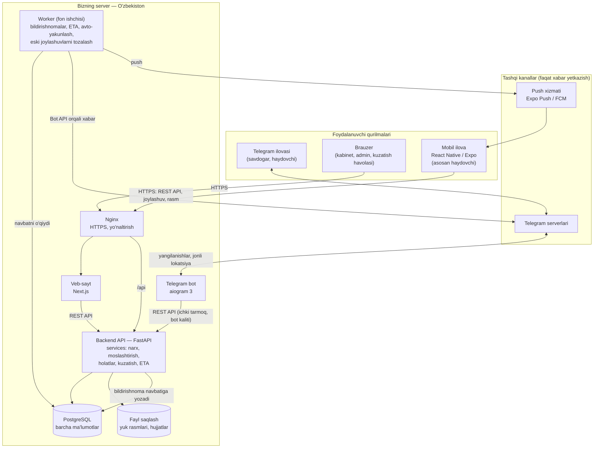

**Tushuntirish.** Uchta mijoz (bot, sayt, ilova) hech qachon bazaga to'g'ridan-to'g'ri ulanmaydi — hammasi bitta **Backend API** orqali ishlaydi, shuning uchun narx hisoblash yoki holat o'zgartirish qoidasi bir marta yoziladi. Bildirishnomalar ham bitta joyda: API "kimga, nima" yuborishni bazadagi navbatga yozadi, **worker** esa uni Telegram yoki push orqali yuboradi (internet uzilsa — qayta urinadi). Ma'lumotlar (baza va rasmlar) faqat O'zbekistondagi serverimizda turadi; Telegram va push xizmati faqat qisqa xabarni yetkazuvchi "pochtachi" vazifasida (8-bo'limdagi 5-savolga qarang).

---

## 2. Ma'lumotlar bazasi sxemasi (ER)

Jadvallar ko'p bo'lgani uchun sxema 4 qismga bo'lindi. Barcha jadvallarda `id` (BIGINT), `created_at` va kerak joyda `updated_at` bor — diagrammada takrorlanmadi.

### 2.1. Foydalanuvchilar, haydovchilar, kirish

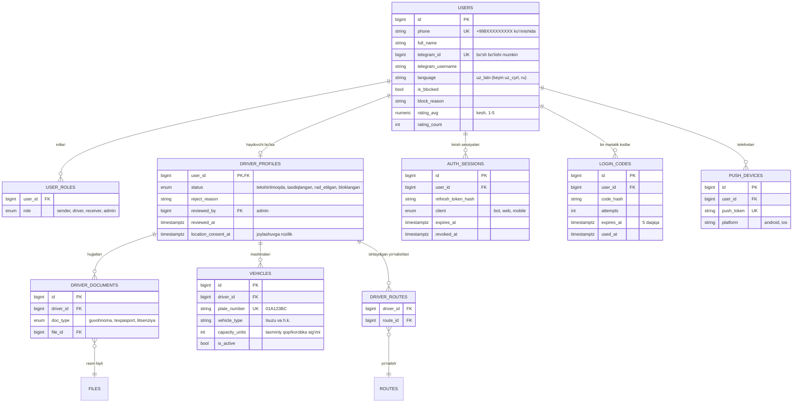

**Tushuntirish.** Har bir odam — bitta `USERS` yozuvi, telefon raqami bilan; u bir nechta rolga ega bo'lishi mumkin (masalan, ham yuboruvchi, ham qabul qiluvchi). Haydovchining qo'shimcha ma'lumotlari, hujjatlari va mashinasi alohida jadvallarda turadi va admin tasdiqlamaguncha holati `tekshirilmoqda` bo'ladi. `AUTH_SESSIONS` va `LOGIN_CODES` — Telegram orqali kirishni xavfsiz qilish uchun (kodlar va tokenlar bazada ochiq holda emas, faqat "hash" ko'rinishida saqlanadi).

### 2.2. Geografiya, yo'nalishlar, tariflar

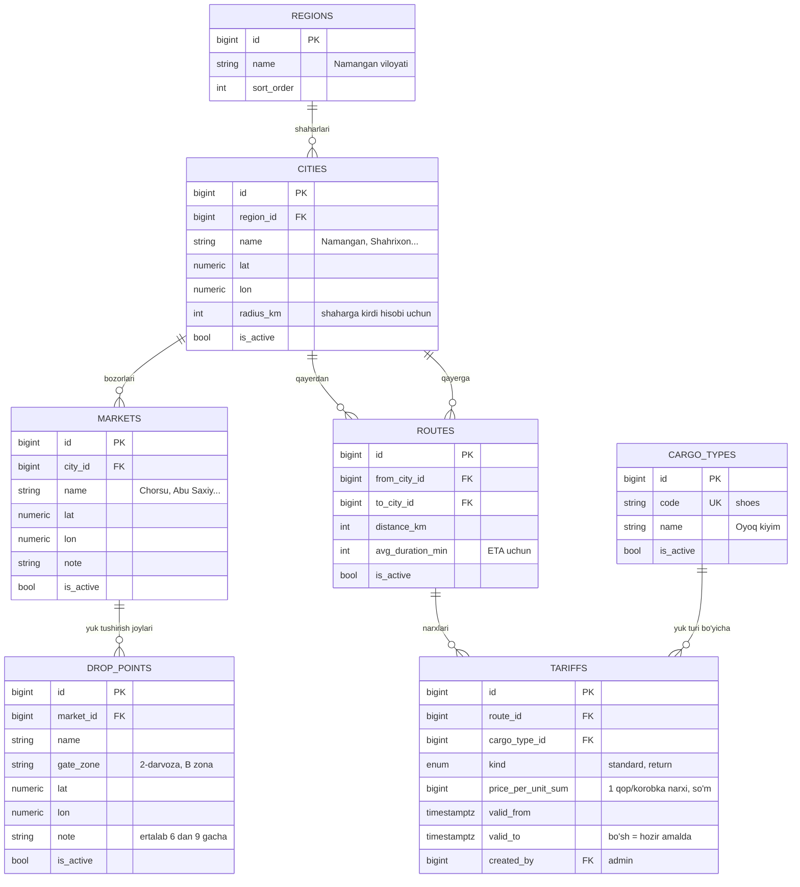

**Tushuntirish.** Kodda hech qanday shahar yoki bozor nomi yozilmaydi: viloyat → shahar → bozor → yuk tushirish joyi zanjiri to'liq bazada va admin saytdan qo'shadi (xaritada belgilab). Yo'nalish ikki shahar orasida bo'ladi (Namangan → Toshkent va Toshkent → Namangan — alohida yo'nalishlar). Tarif o'zgarganda eski narx o'chirilmaydi, balki yangi yozuv qo'shiladi — shunda eski buyurtmalar qaysi narxda hisoblangani doim ko'rinadi.

### 2.3. Buyurtma, reys, kuzatish

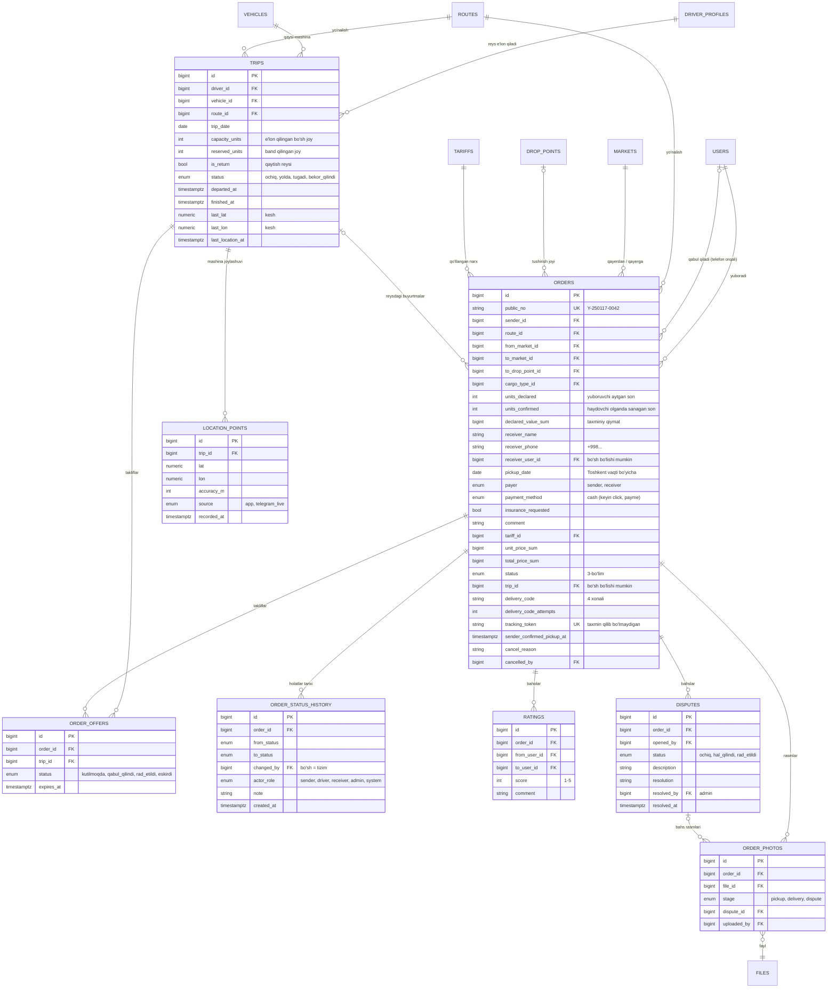

**Tushuntirish.** `ORDERS` — bitta savdogarning bitta yuki; `TRIPS` — haydovchining bitta qatnovi, bitta reysga ko'p buyurtma yig'iladi (`trip_id` orqali) va `reserved_units` sig'imdan oshib ketmasligini tizim tekshiradi. Buyurtmadagi narx (`unit_price_sum`, `total_price_sum`) yaratilgan paytda "muzlatib" qo'yiladi — admin keyin tarifni o'zgartirsa ham eski buyurtma narxi o'zgarmaydi. Qabul qiluvchi telefon raqami orqali bog'lanadi: u ro'yxatdan o'tmagan bo'lsa ham yuk yaratiladi, ro'yxatdan o'tganda esa unga kelayotgan barcha yuklar avtomatik ko'rinadi.

### 2.4. Tizim jadvallari

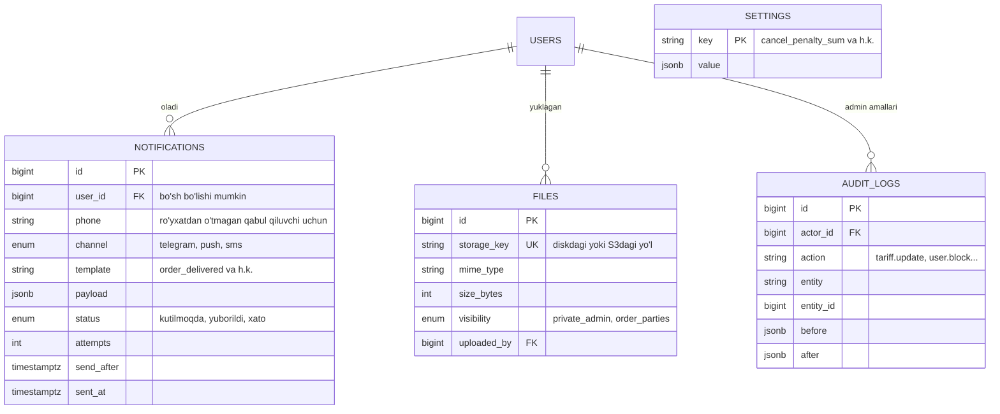

**Tushuntirish.** `NOTIFICATIONS` — bildirishnomalar navbati: API bu yerga yozadi, worker o'qib yuboradi, xato bo'lsa qayta urinadi; `channel` ichida `sms` ham bor — keyin SMS qo'shilganda jadval o'zgarmaydi. `AUDIT_LOGS` admin qilgan har bir muhim ish (tarif o'zgartirish, bloklash, haydovchini tasdiqlash)ni "kim, qachon, nima edi, nima bo'ldi" ko'rinishida saqlaydi. `SETTINGS` — kodni o'zgartirmasdan sozlanadigan qiymatlar (masalan, bekor qilish jarimasi — hozircha 0).

---

## 3. Buyurtma holatlari (state machine)

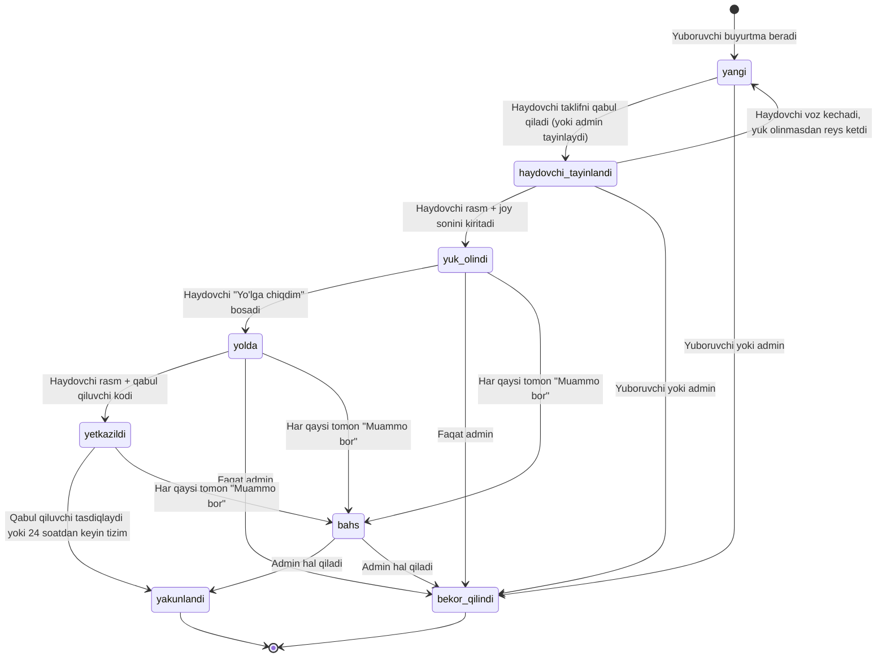

Kim qaysi o'tishni qila oladi:

| O'tish | Kim | Shart / dalil |
|---|---|---|
| `yangi` → `haydovchi_tayinlandi` | Haydovchi (taklifni qabul qiladi), admin | Haydovchi `tasdiqlangan`, reysda bo'sh joy yetarli |
| `haydovchi_tayinlandi` → `yangi` | Haydovchi, tizim | Haydovchi voz kechsa yoki reys yo'lga chiqib, bu yuk olinmagan bo'lsa; yuboruvchiga xabar |
| `haydovchi_tayinlandi` → `yuk_olindi` | Haydovchi | Kamida 1 ta rasm + sanagan joy soni. Son farq qilsa — ogohlantirish. Yuboruvchi "Tasdiqlayman" bosadi (`sender_confirmed_pickup_at`) |
| `yuk_olindi` → `yolda` | Haydovchi | Reys bo'yicha bitta tugma: reysdagi barcha olingan yuklar birdan `yolda` bo'ladi, joylashuv kuzatish boshlanadi |
| `yolda` → `yetkazildi` | Haydovchi | Kamida 1 ta rasm + to'g'ri 4 xonali kod. 5 marta xato kiritilsa — kod bloklanadi, admin aralashadi |
| `yetkazildi` → `yakunlandi` | Qabul qiluvchi, tizim (24 soatdan keyin), admin | Bahs ochilmagan bo'lsa. Shundan keyin baho so'raladi |
| → `bekor_qilindi` | Yuk olinmaguncha: yuboruvchi, admin. Yuk olingandan keyin: faqat admin | Sabab majburiy. Jarima `SETTINGS` dan (hozir 0) |
| → `bahs` | Yuboruvchi, haydovchi, qabul qiluvchi | Izoh majburiy, rasm ixtiyoriy |
| `bahs` → yakuniy holat | Faqat admin | Qaror matni saqlanadi |

**Tushuntirish.** Buyurtma faqat chizmadagi strelkalar bo'yicha o'tadi — boshqa har qanday o'tishni backend rad etadi (masalan, `yangi` dan to'g'ridan-to'g'ri `yetkazildi` ga o'tib bo'lmaydi). Har bir o'tish `ORDER_STATUS_HISTORY` ga vaqt, kim va qaysi rolda qilgani bilan yoziladi — bahs paytida admin shuni ko'radi. Bu qoidalar `backend/app/services/order_status.py` da bitta joyda yoziladi va to'liq testlar bilan qoplanadi.

Reys (`TRIPS`) holatlari soddaroq: `ochiq` (buyurtma yig'ilmoqda) → `yolda` → `tugadi` (barcha yuklar yetkazilganda avtomatik), yoki `bekor_qilindi`.

---

## 4. Asosiy jarayonlar (sequence)

### 4.1. Kirish (login)

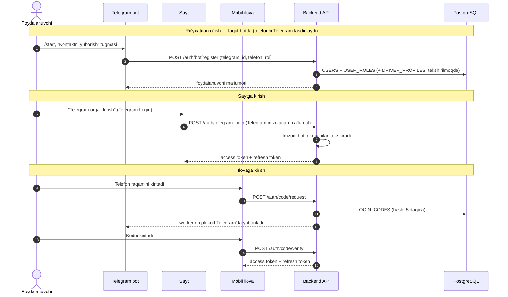

**Tushuntirish.** Ro'yxatdan o'tish botda boshlanadi, chunki Telegram "kontakt yuborish" orqali telefon raqami haqiqatan shu odamniki ekanini kafolatlaydi — SMS kerak emas. Saytda Telegram'ning rasmiy kirish tugmasi ishlatiladi, ilovada esa bot yuborgan bir martalik kod. Bot o'zi API'ga maxsus "bot kaliti" bilan murojaat qiladi va qaysi Telegram foydalanuvchi nomidan ishlayotganini aytadi.

### 4.2. Buyurtma → moslashtirish → yuk olish → yo'l → yetkazish

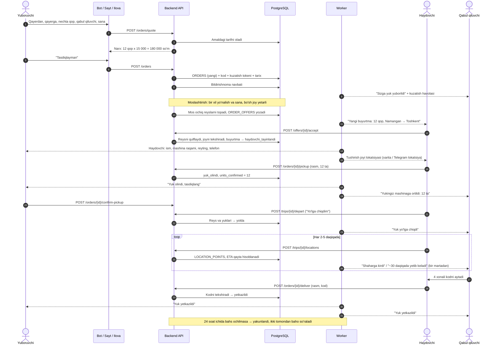

**Tushuntirish.** Yuboruvchi buyurtma berishdan oldin narxni ko'radi; tasdiqlagach tizim mos reysli haydovchilarga taklif yuboradi (haydovchi reys e'lon qilganda ham shu qidiruv ishlaydi, faqat teskari yo'nalishda). Haydovchi taklifni qabul qilganda baza reysni qisqa vaqtga "qulflaydi" — ikki haydovchi yoki ikki buyurtma bir vaqtda oxirgi bo'sh joyni egallab, sig'imdan oshib ketolmaydi. Har bir muhim qadamda rasm va son (yuk olishda) yoki kod (yetkazishda) dalil sifatida saqlanadi.

### 4.3. Qabul qiluvchining yukni kuzatishi

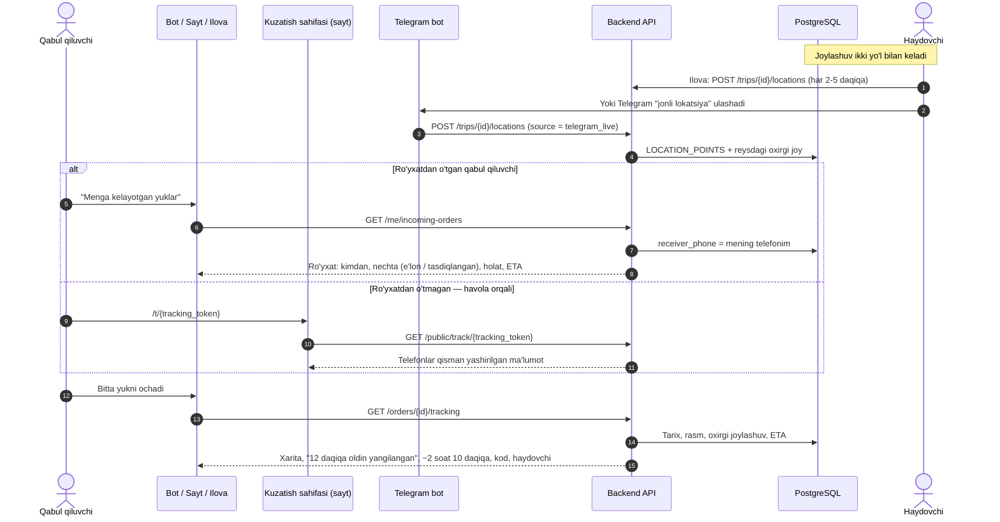

**Tushuntirish.** Qabul qiluvchi uchun ikki yo'l bor: ro'yxatdan o'tgan bo'lsa — telefon raqamiga bog'langan barcha yuklarni "Menga kelayotgan yuklar" bo'limida ko'radi; o'tmagan bo'lsa — yuboruvchi bergan maxsus havola orqali (login kerak emas, telefonlar `+998 90 *** ** 67` ko'rinishida). Mashina joylashuvi haydovchi ilovasidan yoki Telegram jonli lokatsiyasidan keladi va faqat reys `yolda` holatida qabul qilinadi. Taxminiy yetib kelish vaqti (ETA) boshida oddiy hisob: qolgan masofa ÷ yo'nalishning o'rtacha tezligi (`distance_km / avg_duration_min`); joylashuv bo'lmasa — jo'nash vaqti + `avg_duration_min`.

---

## 5. Papka tuzilmasi

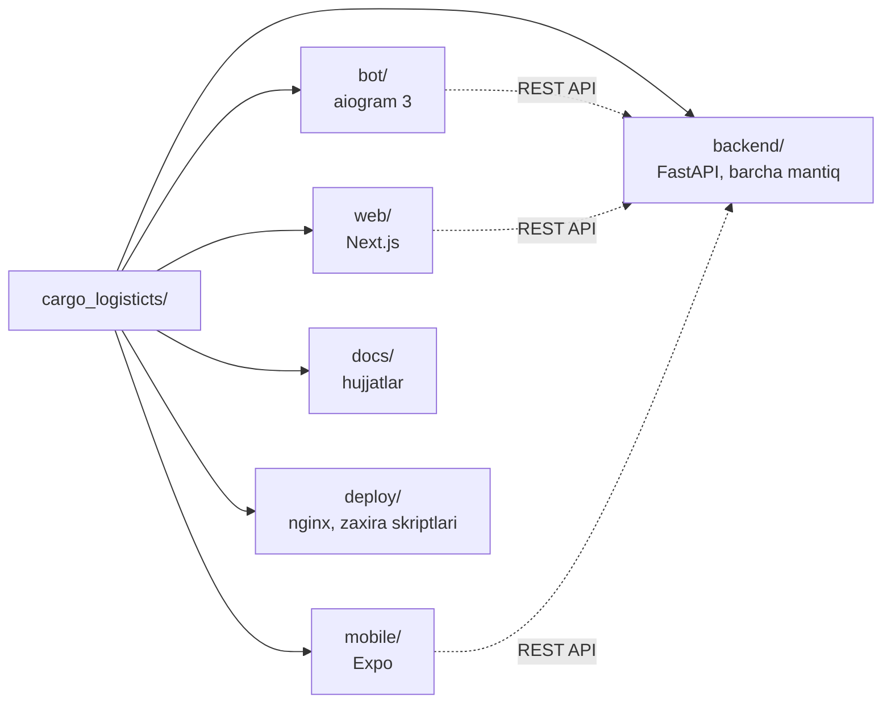

```text
cargo_logisticts/
├── CLAUDE.md                 # loyiha konteksti (sessiyalar uchun)
├── README.md                 # o'zbekcha: Ubuntu'da qanday ishga tushirish
├── .env.example              # maxfiy kalitlar namunasi (.env gitga tushmaydi)
├── docker-compose.yml        # lokal ishga tushirish
├── docker-compose.prod.yml   # serverdagi qo'shimchalar
├── backend/
│   ├── app/
│   │   ├── main.py           # FastAPI ilovasi
│   │   ├── core/             # sozlamalar, baza ulanishi, xavfsizlik, vaqt zonasi
│   │   ├── models/           # SQLAlchemy jadvallari
│   │   ├── schemas/          # Pydantic: API kiradigan/chiqadigan ma'lumotlar
│   │   ├── api/v1/           # endpointlar (faqat qabul qiladi va services'ni chaqiradi)
│   │   ├── services/         # BIZNES MANTIQ: pricing, matching, order_status, tracking, eta...
│   │   ├── notifications/    # bildirishnoma yuborishning yagona joyi (telegram, push, keyin sms)
│   │   ├── storage/          # fayl saqlash: local.py (hozir), s3.py (keyin)
│   │   ├── workers/          # fon ishlari: navbat, avto-yakunlash, tozalash
│   │   └── i18n/             # xabar matnlari: uz_latn.json (keyin uz_cyrl, ru)
│   ├── migrations/           # Alembic migratsiyalari
│   ├── tests/                # pytest
│   └── pyproject.toml
├── bot/
│   ├── app/
│   │   ├── handlers/         # /start, ro'yxatdan o'tish, buyurtma, reys...
│   │   ├── keyboards/        # tugmalar
│   │   ├── api_client.py     # backend API bilan gaplashish
│   │   └── locales/          # bot matnlari
│   └── pyproject.toml
├── web/
│   ├── src/app/              # sahifalar: kabinet, admin/, t/[token] (kuzatish)
│   ├── src/components/
│   ├── src/lib/api/          # openapi.json dan yaratilgan turlar + mijoz
│   └── src/locales/
├── mobile/
│   ├── app/                  # ekranlar (Expo Router)
│   ├── src/lib/api/          # openapi.json dan yaratilgan turlar + mijoz
│   ├── src/location/         # reys davomida joylashuv yuborish
│   └── src/locales/
├── deploy/
│   ├── nginx/                # nginx sozlamalari
│   └── backup/               # backup.sh, restore.sh
└── docs/
    ├── architecture.md       # shu fayl
    ├── deploy.md             # serverga deploy qo'llanmasi (6-bosqich)
    ├── backup.md             # zaxira qo'llanmasi (6-bosqich)
    └── play-store.md         # Google Play'ga chiqarish (6-bosqich)
```

**Tushuntirish.** Bitta repozitoriyda beshta asosiy papka: `backend/` — miya (barcha qoidalar), `bot/`, `web/`, `mobile/` — faqat ko'rinish va tugmalar, `docs/` — hujjatlar. Promptdagi ro'yxatga faqat bitta `deploy/` papkasi qo'shildi — server sozlamalari va zaxira skriptlari kod bilan aralashmasligi uchun. Backend ichida `api/` faqat so'rovni qabul qiladi, haqiqiy ish esa `services/` da — shuning uchun mantiqni bot, sayt yoki ilovadan qat'i nazar bir xil testlash mumkin.

---

## 6. Deploy sxemasi va zaxira

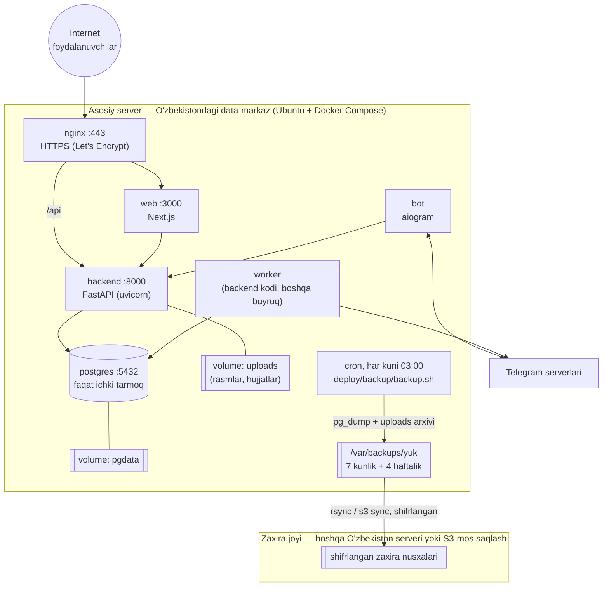

**Tushuntirish.** Hammasi bitta O'zbekistondagi serverda Docker Compose bilan ishlaydi: tashqariga faqat nginx (443-port, HTTPS) ochiq, baza esa faqat ichki tarmoqda — internetdan unga ulanib bo'lmaydi. Har kecha soat 03:00 da skript bazani (`pg_dump`) va yuklangan rasmlarni arxivlaydi, serverda 7 kunlik va 4 haftalik nusxani saqlaydi va shifrlangan holda O'zbekistondagi ikkinchi joyga ko'chiradi. Oyiga bir marta zaxiradan qayta tiklashni sinab ko'rish qo'llanmaga kiritiladi — tekshirilmagan zaxira zaxira emas.

Boshida bot Telegram'dan yangilanishlarni **long polling** bilan oladi (domen va sertifikatsiz ham ishlaydi); keyin kerak bo'lsa webhook'ga o'tkaziladi. Mobil ilova Expo EAS orqali yig'iladi — u yerga faqat dastur kodi boradi, foydalanuvchi ma'lumotlari emas.

---

## 7. Muhim texnik qoidalar

**Ma'lumotlar O'zbekistonda**
- Baza va barcha fayllar faqat bizning O'zbekistondagi serverda. Supabase, Firebase (ma'lumot saqlash), AWS va boshqa xorijiy bulutlar ishlatilmaydi.
- Telegram va push xabarlarida shaxsiy ma'lumot minimal: masalan, *"Y-250117-0042 yukingiz yetkazildi"*. Batafsil ma'lumot (telefon, ism) faqat bizning API'dan ilova yoki bot ichida olinadi. (8-bo'limdagi 5-savol.)

**Xavfsizlik**
- Hujjat rasmlari (`visibility = private_admin`) faqat adminlarga, yuk rasmlari faqat buyurtma tomonlariga; fayllar ochiq papkadan emas, ruxsatni tekshiradigan API orqali (yoki qisqa muddatli imzolangan havola bilan) beriladi.
- Kuzatish tokeni — kamida 128 bit tasodifiy (`secrets.token_urlsafe`), taxmin qilib bo'lmaydi.
- Yetkazish kodi — 4 xonali, 5 marta xato kiritilsa bloklanadi; bir martalik kirish kodlari va refresh tokenlar faqat hash ko'rinishida.
- Login, kod tekshirish va ochiq kuzatish endpointlariga so'rovlar soni cheklanadi (rate limit).
- Bloklangan foydalanuvchining tokenlari darhol bekor qilinadi.

**Ma'lumot formati**
- Pul — `BIGINT`, so'm. Narx = `price_per_unit_sum × units` — faqat butun sonlar.
- Vaqt — bazada `timestamptz` (UTC), foydalanuvchiga Asia/Tashkent bo'yicha. "Bugun/ertaga" va `pickup_date` Toshkent sanasi bo'yicha hisoblanadi.
- Telefon — doim `+998XXXXXXXXX` ko'rinishiga keltiriladi (qabul qiluvchini topish shunga bog'liq).

**Joylashuv**
- Haydovchi ro'yxatdan o'tishda joylashuv faqat reys `yolda` bo'lganda yuborilishini ko'radi va rozilik beradi (`location_consent_at`).
- Reys tugashi bilan ilova joylashuv yuborishni to'xtatadi, backend esa bu reysga joylashuv qabul qilmaydi.
- `LOCATION_POINTS` dagi eski nuqtalar ma'lum muddatdan keyin (masalan, 90 kun) worker tomonidan o'chiriladi.

**Kelajakka tayyorlik** (hozir qilinmaydi, lekin joy qoldirilgan)
- To'lov: `payment_method` enum + alohida `payments` servisi qo'shiladi (Click/Payme).
- SMS: `notifications` ichida `sms` kanali — mahalliy provayder ulanadi.
- Sug'urta: `insurance_requested` belgisi saqlanadi.
- Ko'p til: barcha matnlar `i18n` fayllarida.
- AI ovozli dispetcher va aniqroq ETA: ular ham xuddi shu `services/` funksiyalarini chaqiradi, alohida mantiq yozilmaydi.
- iOS: Expo bitta kod bilan.

---

## 8. Ochiq savollar (javobingiz kerak)

Quyidagilarni taxmin qilmadim, chunki ular biznes qaroringiz. Har biriga mening taklifim yozilgan — "ha" desangiz, shunday qilaman.

1. **Qaytish tarifi qanday qo'llanadi?** Yuboruvchi buyurtma berayotganda reys hali noma'lum.
   *Taklif:* buyurtma standart narx bilan ochiladi; agar u qaytish reysiga (`is_return = true`) tushsa, narx avtomatik arzon tarifga tushadi va yuboruvchiga xabar boriladi. Narx hech qachon oshmaydi.
2. **Qop va korobka narxi bir xilmi?** Hozircha sxemada bitta "joy" (qop yoki korobka) narxi bor.
   *Taklif:* boshida bir xil; farq kerak bo'lsa, tarifga `unit_type` qo'shamiz.
3. **Yuk olishda son farq qilsa nima bo'ladi?** Masalan, yuboruvchi 12 dedi, haydovchi 11 sanadi.
   *Taklif:* narx haydovchi tasdiqlagan son bo'yicha qayta hisoblanadi, yuboruvchi "Tasdiqlayman" yoki "Muammo bor" tugmasini bosadi; bosmasa 2 soatdan keyin avtomatik tasdiqlangan hisoblanadi. Yuboruvchi tasdig'i holatni to'xtatib turmaydi (haydovchi kutib qolmasin).
4. **`yetkazildi` → `yakunlandi` qachon?**
   *Taklif:* qabul qiluvchi "Oldim" bossa darhol, aks holda 24 soatdan keyin avtomatik (shu 24 soat ichida bahs ochish mumkin).
5. **Telegram va push xorijiy kanallar.** Telegram serverlari ham, Android push (Google FCM) ham O'zbekistonda emas — ularsiz bot va push umuman ishlamaydi.
   *Taklif:* ma'lumotlar bazasi to'liq O'zbekistonda; Telegram/push orqali faqat qisqa, shaxsiy ma'lumotsiz matn yuboriladi (7-bo'lim). Huquqiy jihatdan yuristga bir marta ko'rsatib olishni maslahat beraman.
6. **Xarita.** Saytda va ilovada xaritani nima bilan ko'rsatamiz?
   *Taklif:* boshida **OpenStreetMap** (bepul, saytda Leaflet kutubxonasi). O'zbekistonda Yandex xaritalari aniqroq bo'lishi mumkin, lekin kalit va limitlar kerak — keyin almashtirish oson bo'ladigan qilib yozaman. "Navigatorda ochish" tugmasi Yandex Navigator / Google Maps havolasini ochadi.
7. **Fon ishlari uchun Redis kerakmi?**
   *Taklif:* hozircha yo'q — navbat PostgreSQL jadvalida (`NOTIFICATIONS`), worker uni o'qiydi. Kamroq server qismi, kamroq tashvish.
8. **Bekor qilish qoidasi.** Yuk olingandan keyin yuboruvchi bekor qila olmasligi (faqat admin orqali) to'g'rimi?
   *Taklif:* ha, chunki yuk allaqachon mashinada.
